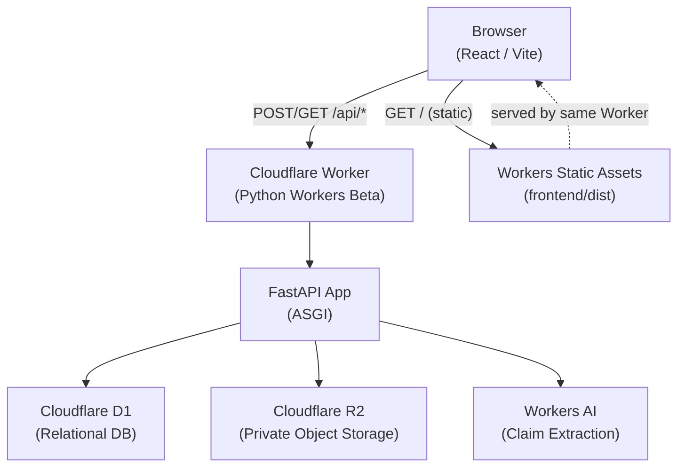

# BRANDCORE — Architecture

**Version:** 0.1.0 · **Owner:** Mritunjay Singh · **Tier:** T2
**Runtime caveat:** Cloudflare Python Workers are Beta at time of writing. This architecture is conditional on the proof-of-concept gate passing. See §8.

---

## 1. Single Cloudflare Worker Architecture

One Cloudflare Worker serves both the frontend static assets and the backend API. The browser communicates only with the Worker. The Worker holds all Cloudflare binding access (D1, R2, Workers AI). The browser has no direct binding access.



---

## 2. Frontend / API Request Flow

1. Browser loads `index.html` and static assets from Workers Static Assets.
2. All API calls use relative `/api/*` paths — no hardcoded origins.
3. The Worker routes `/api/*` requests to the FastAPI ASGI app.
4. FastAPI validates input with Pydantic, calls repositories, and returns JSON.
5. Repositories access D1 via parameterized statements only.
6. R2 access is through signed backend operations only.
7. Workers AI is called from backend services only; output is validated with Pydantic before use.

---

## 3. FastAPI Layers

```
backend/src/
├── worker.py              # Cloudflare Worker entry point (ASGI bridge)
└── app/
    ├── main.py            # FastAPI app factory, middleware, router registration
    ├── api/
    │   └── health.py      # GET /api/health
    ├── core/              # Config, logging, error handling
    ├── domain/            # Pydantic models and domain types
    ├── repositories/      # D1 and R2 access (parameterized SQL only)
    └── services/          # Business logic, AI orchestration, deterministic checks
```

**Layer rules:**
- SQL lives only in `repositories/`. Never in route handlers, services or React components.
- AI calls live only in `services/`. Output is always validated with Pydantic before use.
- Deterministic checks live in `services/` and are authoritative over AI output.

---

## 4. Cloudflare Bindings

| Binding | Type | Access | Purpose |
|---------|------|--------|---------|
| `DB` | D1 | Backend only | Relational data store |
| `ASSETS` | R2 | Backend only | Private evidence and asset storage |
| `AI` | Workers AI | Backend only | Claim extraction and explanation |

The browser has no direct access to any binding. All binding access is through authenticated FastAPI routes.

---

## 5. D1 Relational Entities and Relationships

Conceptual entities (schema to be defined in a later bounded task after the D1 proof-of-concept gate passes):

| Entity | Key Fields | Notes |
|--------|-----------|-------|
| `workspace` | id, name, demo_flag | Scopes all data |
| `evidence` | id, workspace_id, source_url, version | Immutable versions |
| `approved_fact` | id, workspace_id, evidence_id, scope, qualifier, version | Versioned |
| `policy` | id, workspace_id, version | Versioned |
| `terminology` | id, workspace_id, term, status | Allow/deny list |
| `content_item` | id, workspace_id, title | Parent record |
| `content_version` | id, content_item_id, body_text, sha256_hash | Immutable |
| `candidate_claim` | id, content_version_id, text, extracted_by | AI-extracted |
| `verification_finding` | id, content_version_id, claim_id, finding_type, reason | Deterministic |
| `claim_fact_dependency` | claim_id, fact_version_id | Links claims to facts |
| `review_decision` | id, content_version_id, reviewer_id, decision, timestamp | Human only |
| `release_passport` | id, content_version_id, content_hash, policy_version_id, status | Immutable snapshot |
| `release_status_event` | id, passport_id, status, reason, timestamp | Append-only |
| `audit_event` | id, workspace_id, actor_id, action, timestamp | Append-only |

---

## 6. Evidence-to-Release Dependency Chain

```
Evidence Source
    └── Approved Fact Version
            └── Candidate Claim (in Content Version)
                    └── Content Version (immutable, SHA-256 hashed)
                            └── Release Passport (snapshot of versions used)
                                    └── Release Status Event (VALID → STALE → REVOKED)
```

When an approved fact version changes:
1. A new fact version is created (old version is preserved).
2. The system queries `claim_fact_dependency` to find all content versions that used the old fact version.
3. Dependent Release Passports receive a `STALE` status event.
4. The historical passport is never rewritten.
5. Revalidation creates a new review and, if approved, a new release record.

---

## 7. AI vs Deterministic Responsibility

| Responsibility | Owner | Rationale |
|---------------|-------|-----------|
| Extract candidate claims | AI (Workers AI) | Semantic task |
| Classify language and qualifiers | AI | Semantic task |
| Explain a finding | AI | Natural language |
| Suggest revised wording | AI | Natural language |
| Exact numeric comparisons | Deterministic engine | Must be exact |
| Dates and expiry | Deterministic engine | Must be exact |
| Terminology allow/deny | Deterministic engine | Must be exact |
| Required qualifiers | Deterministic engine | Must be exact |
| Scope constraints | Deterministic engine | Must be exact |
| Content hashes | Deterministic engine | Cryptographic |
| Policy/evidence version IDs | Deterministic engine | Must be exact |
| Dependency traversal | Deterministic engine | Must be exact |
| Release state transitions | Deterministic engine | Must be exact |
| Approve/reject content | Human only | Non-delegable |

AI output is always untrusted until validated with Pydantic. AI cannot approve content or change release status.

---

## 8. Release Passport Integrity

A Release Passport is an immutable snapshot created at the moment of human approval. Required fields:

- `release_id` — unique identifier
- `content_sha256` — SHA-256 hash of the exact content body
- `content_version_id` — foreign key to the immutable content version
- `policy_version_id` — policy version in effect at approval time
- `fact_evidence_versions` — JSON array of all fact/evidence version IDs used
- `finding_ids_and_dispositions` — JSON array of finding IDs and reviewer dispositions
- `approver_id` — human reviewer identity (demo: role label)
- `decision_timestamp` — ISO 8601 UTC
- `audit_reference` — foreign key to audit event

The passport row is never updated. Status changes are recorded as `release_status_event` rows only.

---

## 9. Runtime Caveat and Proof Gate

**Cloudflare Python Workers are Beta.** This architecture is conditional on the following proof-of-concept checks passing:

| Check | Status | Evidence | Date |
|-------|--------|----------|------|
| FastAPI health endpoint runs in pywrangler local dev | **PASS_LOCAL** | `curl http://localhost:8787/api/health` → `{"status":"ok","version":"0.1.0"}` HTTP 200; `uv run pywrangler dev --local` started successfully with wrangler 4.157.0 | 2026-11-04 |
| Vite production build served by same Worker via Workers Static Assets | **PASS_LOCAL** | `curl -w HTTP_STATUS:%{http_code} http://localhost:8787/` → HTTP 200 `text/html`; `npm run build` produced 145.63 kB JS (47.08 kB gzip) | 2026-11-04 |
| D1 binding performs parameterized write and read in Python Worker runtime | **PASS_LOCAL** | `POST /api/poc/d1` → `{"inserted_id":"62af6eff...","read_back_message":"BRANDCORE D1 POC verification record","status":"PASS_LOCAL"}`; migration `0001_poc_records.sql` applied locally | 2026-11-04 |
| R2 binding stores and retrieves a private test object through the backend | **PASS_LOCAL** | `POST /api/poc/r2` → `{"key":"poc/brandcore-poc.txt","content":"BRANDCORE R2 POC verification object","status":"PASS_LOCAL"}` | 2026-11-04 |
| Workers AI binding returns a bounded structured response validated with Pydantic | **PASS_REMOTE** | Gate B and Gate B-sub approved. workers.dev subdomain registered: `brandcore.workers.dev`. Four attempts total. Attempts 1–3 failed (upstream error; Pydantic schema mismatch; schema mismatch on retry). Schema-fix approval granted 2026-11-04: `claim_type: str \| None`, `numeric_value: str \| int \| float \| None`, raw+usage captured before Pydantic. Attempt 4 (final authorization): HTTP 200 (4.262s); Pydantic PASS; `claim_type: null`, `numeric_value: 40` (int) accepted; `unit: "percent"`, `qualifier: "up to"`; prompt_tokens: 86, completion_tokens: 64, total_tokens: 150. Evidence: `docs/evidence/M1-06/attempt-4-final/`. | 2026-11-04 |
| Deployed preview opened and tested | **BLOCKED** | Requires Cloudflare account credentials, workers.dev subdomain registration and explicit deployment approval. | 2026-11-04 |

No product feature work should begin until the Workers AI check passes or is explicitly waived. If the Python Workers Beta proves incompatible, an ADR will document the fallback.

### 9.1 M1-06 Workers AI inference attempt log

All attempts used `POST /api/poc/ai`, model `@cf/meta/llama-3.1-8b-instruct-fp8`, `max_tokens: 256`, and the same synthetic claim in `src/app/api/poc.py` unless noted. No automatic retries exist in the endpoint.

| Attempt | Date | Authorization | Duration | HTTP | Result |
|---------|------|---------------|----------|------|--------|
| 1 | 2026-11-04 | Gate B | 217 ms | 500 | `InferenceUpstreamError`; reference `kpjurgt1no531m46vndh55fu`; no model response |
| 2 | 2026-11-04 | Gate B-sub | 5.165 s | 500 | JSON returned; Pydantic: `claim_type=None`, `numeric_value=40` (int) |
| 3 | 2026-11-04 | Single-retry approval | 3.994 s | 500 | JSON returned; Pydantic: `numeric_value=40` (int) only; `claim_type` passed |
| 4 | 2026-11-04 | Schema-fix + final inference approval | 4.262 s | **200** | **PASS_REMOTE** — Pydantic valid; `claim_type: null`, `numeric_value: 40` (int), `unit: "percent"`, `qualifier: "up to"`; tokens: 86+64=150; raw captured; usage captured |

**Attempt 3 — authorized retry record (2026-11-04):**

```text
Command:
  curl.exe -sS -X POST http://127.0.0.1:8791/api/poc/ai
Model:      @cf/meta/llama-3.1-8b-instruct-fp8
Binding:    env.AI, remote=true (wrangler.jsonc, unchanged)
Input:      same system+user prompt as attempt 2; claim
            "Our platform reduces customer onboarding time by up to 40 percent."
            337 prompt characters total; max_tokens 256
Source:     src/app/api/poc.py SHA-256 F3F3237… (identical before/after)
            wrangler.jsonc     SHA-256 9C9CF99… (identical before/after)
Response:   HTTP/1.1 500 Internal Server Error
            Content-Type: text/plain; charset=utf-8
            Body: Internal Server Error
Validation: FAIL — pydantic_core.ValidationError at poc.py:122
            numeric_value: Input should be a valid string
            [type=string_type, input_value=40, input_type=int]
Token usage: NOT CAPTURED (see below)
Outcome:    FAIL; M1-06 remains BLOCKED
```

**Why token usage is missing:** `poc.py` reads `result["usage"]` only on the success path. The Pydantic exception at line 122 discards `result`, and the application does not log the raw response. The retry authorization forbade code changes and allowed no second inference, so no actual token count exists for this attempt. Capturing usage requires logging the raw binding result before validation; that change needs explicit approval and must be recorded as a follow-up to M1-06 / M3-01.

**Evidence bundle — attempt 3:** `docs/evidence/M1-06/attempt-3-2026-11-04/` (`metadata.txt`, `response.headers.txt`, `response.body.txt`, `traceback.log`).

**Evidence bundle — attempt 4 (PASS):** `docs/evidence/M1-06/attempt-4-final/` (`metadata.txt`, `response.headers.txt`, `response.body.txt`).


**Runtime version confirmed:** Pyodide 3.14.2 (CPython 3.14) — verified by `pywrangler sync` installing `pyodide-py==314.0.7`. `compatibility_date` updated to `2026-09-08` to enable the Python 3.14 runtime.

**Verification rule:** Verify current official Cloudflare documentation and package compatibility before choosing or updating package versions and Wrangler/Pywrangler configuration. Record the date and official URLs in this document and in `docs/TOOLING_AUDIT.md`. Never invent a successful integration.

---

## 10. Local Development

```bash
# Frontend (Vite dev server)
cd frontend && npm install && npm run dev

# Backend (pywrangler local dev)
cd backend && uv sync && pywrangler dev

# Combined (both in separate terminals)
# Frontend: http://localhost:5173
# Backend/Worker: http://localhost:8787
```

Local dev uses `.dev.vars` for secrets (never committed). See `.dev.vars.example` for required variable names.

---

## References

- Cloudflare Python Workers: https://developers.cloudflare.com/workers/languages/python/ (verify current docs)
- Cloudflare D1: https://developers.cloudflare.com/d1/
- Cloudflare R2: https://developers.cloudflare.com/r2/
- Cloudflare Workers AI: https://developers.cloudflare.com/workers-ai/
- Workers Static Assets: https://developers.cloudflare.com/workers/static-assets/
- Wrangler: https://developers.cloudflare.com/workers/wrangler/
- Pywrangler: https://developers.cloudflare.com/workers/languages/python/packages/ (verify current name/package)

*Last verified: 2026-11-04 — URLs are pointers; verify current content before implementation.*
