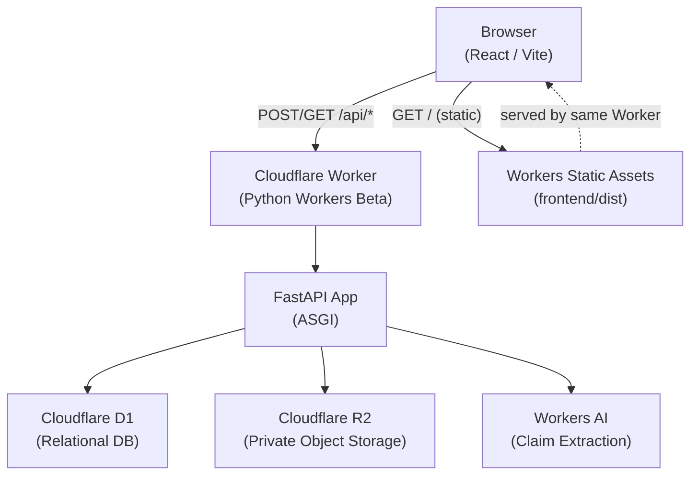

# BRANDCORE — Architecture

**Version:** 0.1.0 · **Owner:** Mritunjay Singh · **Tier:** T2
**Runtime caveat:** Cloudflare Python Workers are Beta at time of writing. This architecture is conditional on the proof-of-concept gate passing. See §8.

---

## 1. Single Cloudflare Worker Architecture

One Cloudflare Worker serves both the frontend static assets and the backend API. The browser communicates only with the Worker. The Worker holds all Cloudflare binding access (D1, R2, Workers AI). The browser has no direct binding access.



---

## 2. Frontend / API Request Flow

1. Browser loads `index.html` and static assets from Workers Static Assets.
2. All API calls use relative `/api/*` paths — no hardcoded origins.
3. The Worker routes `/api/*` requests to the FastAPI ASGI app.
4. FastAPI validates input with Pydantic, calls repositories, and returns JSON.
5. Repositories access D1 via parameterized statements only.
6. R2 access is through signed backend operations only.
7. Workers AI is called from backend services only; output is validated with Pydantic before use.

---

## 3. FastAPI Layers

```
backend/src/
├── worker.py              # Cloudflare Worker entry point (ASGI bridge)
└── app/
    ├── main.py            # FastAPI app factory, middleware, router registration
    ├── api/
    │   ├── health.py      # GET /api/health
    │   ├── poc.py         # POC endpoints (D1, R2, Workers AI) — development only
    │   ├── dependencies.py # POC route security guard
    │   └── analyze.py     # POST /api/workspaces/{id}/content/{vid}/analyze
    ├── core/              # Config, logging, error handling
    ├── domain/            # Pydantic models and domain types
    ├── repositories/      # D1 and R2 access (parameterized SQL only)
    └── services/          # Business logic, AI orchestration, deterministic checks
```

**Layer rules:**
- SQL lives only in `repositories/`. Never in route handlers, services or React components.
- AI calls live only in `services/`. Output is always validated with Pydantic before use.
- Deterministic checks live in `services/` and are authoritative over AI output.

---

## 4. Cloudflare Bindings

| Binding | Type | Access | Purpose |
|---------|------|--------|---------|
| `DB` | D1 | Backend only | Relational data store |
| `ASSETS` | R2 | Backend only | Private evidence and asset storage |
| `AI` | Workers AI | Backend only | Claim extraction and explanation |

The browser has no direct access to any binding. All binding access is through authenticated FastAPI routes.

---

## 5. D1 Relational Entities and Relationships

### 5.1 M2-01 — Core data foundation (VERIFIED 2026-11-04, migration 0002)

| Table | Key Columns | Constraints | Notes |
|-------|-------------|-------------|-------|
| `workspace` | id TEXT PK, name, slug, demo_flag, status, created_at, updated_at | UNIQUE(slug); CHECK demo_flag IN (0,1); CHECK status IN ('active','archived') | Scopes all data |
| `evidence` | id TEXT PK, workspace_id FK, title, source_type, summary, source_url, version, status, created_at | UNIQUE(workspace_id, id); CHECK source_type IN (...); CHECK status IN ('active','superseded','retracted'); ON DELETE RESTRICT | Immutable rows; new version = new row; ai_generated rejected at DB level |
| `approved_fact` | id TEXT PK, workspace_id FK, claim_text, numeric_value TEXT, unit, qualifier, scope, version, status, previous_version_id, created_by, created_at | UNIQUE(workspace_id, id); CHECK status IN ('active','superseded','retracted'); ON DELETE RESTRICT | Versioned; old versions preserved |
| `fact_evidence` | fact_id, fact_workspace, evidence_id, ev_workspace, linked_at | PK(fact_id, evidence_id); composite FKs to approved_fact(id,workspace_id) and evidence(id,workspace_id); CHECK fact_workspace = ev_workspace | Many-to-many; workspace isolation enforced at DB level |
| `policy` | id TEXT PK, workspace_id FK, name, description, rules_json, version, status, previous_version_id, created_by, created_at | UNIQUE(workspace_id, id); CHECK rules_json starts with [ or {; CHECK status IN ('active','superseded','archived'); ON DELETE RESTRICT | Versioned; rules stored as JSON array |
| `terminology` | id TEXT PK, workspace_id FK, term, status, notes, created_at, updated_at | UNIQUE(workspace_id, term); CHECK status IN ('approved','denied','preferred'); ON DELETE RESTRICT | One entry per term per workspace |

**Indexes (11 total):** workspace(status); evidence(workspace_id), evidence(workspace_id, status); approved_fact(workspace_id), approved_fact(workspace_id, status); fact_evidence(fact_id), fact_evidence(evidence_id); policy(workspace_id), policy(workspace_id, status); terminology(workspace_id), terminology(workspace_id, status).

**Fact-to-evidence relationship:** Many-to-many via `fact_evidence` join table. A single approved fact can cite multiple supporting evidence records. This supersedes the single `evidence_id` FK shown in the earlier conceptual model (see ADR-009).

**Workspace isolation:** `fact_evidence` uses composite foreign keys referencing `(id, workspace_id)` on both parent tables, plus a `CHECK (fact_workspace = ev_workspace)` constraint. A fact cannot be linked to evidence from a different workspace at the database level.

**Deletion behaviour:** All business tables use `ON DELETE RESTRICT` on their workspace FK. Evidence and approved_fact rows cannot be deleted while referenced by `fact_evidence`. This preserves the full provenance chain.

### 5.2 M2-02 — Content, claims and verification (VERIFIED 2026-11-05, migration 0003)

| Table | Key Columns | Constraints | Notes |
|-------|-------------|-------------|-------|
| `content_item` | id TEXT PK, workspace_id FK, title, status, created_by, created_at, updated_at | UNIQUE(workspace_id, id); CHECK status IN ('active','archived'); ON DELETE RESTRICT on workspace | Logical content asset; mutable title/status live here |
| `content_version` | id TEXT PK, workspace_id, content_item_id, version_number, body_text, sha256_hash, submitted_by, created_at | UNIQUE(workspace_id, id); UNIQUE(content_item_id, version_number); CHECK version_number >= 1; CHECK length(sha256_hash) = 64; composite FK (content_item_id, workspace_id) → content_item(id, workspace_id) ON DELETE RESTRICT | Immutable snapshot; body in D1 (text only per PRD §7); sha256_hash server-side; immutability enforced by BEFORE UPDATE/BEFORE DELETE triggers |
| `candidate_claim` | id TEXT PK, workspace_id, content_version_id, claim_text, claim_type, numeric_value_text, unit, qualifier, scope, extraction_batch_id, extracted_by, extracted_at | UNIQUE(workspace_id, id); composite FK (content_version_id, workspace_id) → content_version(id, workspace_id) ON DELETE RESTRICT; claim_type/numeric_value_text/unit/qualifier/scope nullable | AI-extracted claim; numeric_value_text stored as TEXT (no float conversion); extraction_batch_id groups one extraction run; never an approved_fact |
| `verification_finding` | id TEXT PK, workspace_id, content_version_id, claim_id (nullable), finding_type, severity, explanation, suggested_correction, analysis_batch_id, created_at | CHECK finding_type IN (7 canonical types); CHECK severity IN ('critical','high','medium','low'); composite FK (content_version_id, workspace_id) → content_version(id, workspace_id) ON DELETE RESTRICT; composite FK (claim_id, workspace_id) → candidate_claim(id, workspace_id) ON DELETE RESTRICT; trigger enforces claim.content_version_id = finding.content_version_id when claim_id set | Deterministic finding; claim_id nullable (content-level findings allowed); analysis_batch_id groups one check run |

**Indexes (13 total):** content_item(workspace_id), content_item(workspace_id, status); content_version(workspace_id), content_version(content_item_id, version_number); candidate_claim(workspace_id), candidate_claim(content_version_id), candidate_claim(extraction_batch_id); verification_finding(workspace_id), verification_finding(content_version_id), verification_finding(claim_id) WHERE claim_id IS NOT NULL, verification_finding(content_version_id, finding_type), verification_finding(analysis_batch_id).

**Relationships:**
```
workspace → content_item → content_version → candidate_claim
content_version → verification_finding
```
A `verification_finding` may also reference a `candidate_claim` from that same `content_version`. Composite foreign keys enforce workspace isolation at every link: a content version cannot reference a content item from another workspace; a claim cannot reference a content version from another workspace; a finding cannot reference a claim from a different content version or workspace.

**Content storage decision:** The `content_version.body_text` content body is stored in D1 (text content only; PRD §7 excludes video/audio review). R2 is reserved for private evidence/assets (see §4 binding table). This matches the existing M2-01 convention and introduces no storage decision that contradicts the architecture.

**Immutability:** `content_version` rows are immutable. `BEFORE UPDATE` and `BEFORE DELETE` triggers abort any mutation with an explicit error message (`content_version rows are immutable: updates/deletes are not permitted`). There is no mutable `current_version` snapshot; the latest version is derived from `version_number`.

**Remaining entities (schema pending M2-03):** `claim_fact_dependency`, `review_decision`, `release_passport`, `release_status_event`, `audit_event` (see §5.3). These are intentionally out of scope for M2-02.

### 5.3 M2-03 — Release governance and dependency chain (VERIFIED 2026-11-05, migration 0004)

| Table | Key Columns | Constraints | Notes |
|-------|-------------|-------------|-------|
| `claim_fact_dependency` | claim_id, fact_version_id, claim_workspace, fact_workspace, linked_at | PK(claim_id, fact_version_id); composite FK (claim_id, claim_workspace) → candidate_claim(id, workspace_id) ON DELETE RESTRICT; composite FK (fact_version_id, fact_workspace) → approved_fact(id, workspace_id) ON DELETE RESTRICT; CHECK claim_workspace = fact_workspace | Links each candidate claim to the approved fact version(s) it depends on; workspace isolation enforced at DB level |
| `review_decision` | id TEXT PK, workspace_id FK, content_version_id FK, reviewer_id, decision, justification, created_at | CHECK decision IN ('approved','request_changes','rejected'); composite FK (content_version_id, workspace_id) → content_version(id, workspace_id) ON DELETE RESTRICT | Human-only decision; one per content version; no auto-approval path |
| `release_passport` | id TEXT PK, workspace_id FK, content_version_id FK, content_hash, policy_version_id, status, previous_passport_id, created_by, created_at | CHECK status IN ('valid','stale','revoked','invalid'); composite FK (content_version_id, workspace_id) → content_version(id, workspace_id) ON DELETE RESTRICT; immutability enforced by BEFORE UPDATE trigger | Immutable snapshot of versions used at approval; `release_passport rows are immutable` |
| `release_status_event` | id TEXT PK, passport_id FK, status, reason, timestamp | composite FK (passport_id, workspace_id) → release_passport(id, workspace_id) ON DELETE RESTRICT | Append-only status transitions (VALID → STALE → REVOKED → INVALID); passport never rewritten |
| `audit_event` | id TEXT PK, workspace_id FK, actor_id, action, target_type, target_id, metadata_json, timestamp | CHECK metadata_json starts with [ or {; composite FK (workspace_id) → workspace(id) ON DELETE RESTRICT | Append-only audit trail; one row per actor action |

**Indexes:** claim_fact_dependency(claim_id), claim_fact_dependency(fact_version_id); review_decision(workspace_id), review_decision(content_version_id); release_passport(workspace_id), release_passport(content_version_id), release_passport(status); release_status_event(passport_id); audit_event(workspace_id), audit_event(timestamp).

**Relationships:**
```
content_version → candidate_claim → claim_fact_dependency → approved_fact
content_version → verification_finding
content_version → review_decision
content_version → release_passport → release_status_event
```

**Passport immutability:** `release_passport` rows are immutable. A `BEFORE UPDATE` trigger aborts any mutation with `release_passport rows are immutable: status changes are recorded as release_status_event rows only`. Historical passports are never rewritten; revalidation creates a new passport.

**Stale detection:** `StaleDetectionRepository` traverses evidence → approved_fact → candidate_claim → content_version → release_passport to find releases affected by a fact version change. Duplicate stale events are prevented by checking `has_status_event` before inserting.


---

## 6. Evidence-to-Release Dependency Chain

```
Evidence Source
    └── Approved Fact Version
            └── Candidate Claim (in Content Version)
                    └── Content Version (immutable, SHA-256 hashed)
                            └── Release Passport (snapshot of versions used)
                                    └── Release Status Event (VALID → STALE → REVOKED)
```

When an approved fact version changes:
1. A new fact version is created (old version is preserved).
2. The system queries `claim_fact_dependency` to find all content versions that used the old fact version.
3. Dependent Release Passports receive a `STALE` status event.
4. The historical passport is never rewritten.
5. Revalidation creates a new review and, if approved, a new release record.

---

## 7. AI vs Deterministic Responsibility

| Responsibility | Owner | Rationale |
|---------------|-------|-----------|
| Extract candidate claims | AI (Workers AI) | Semantic task |
| Classify language and qualifiers | AI | Semantic task |
| Explain a finding | AI | Natural language |
| Suggest revised wording | AI | Natural language |
| Exact numeric comparisons | Deterministic engine | Must be exact |
| Dates and expiry | Deterministic engine | Must be exact |
| Terminology allow/deny | Deterministic engine | Must be exact |
| Required qualifiers | Deterministic engine | Must be exact |
| Scope constraints | Deterministic engine | Must be exact |
| Content hashes | Deterministic engine | Cryptographic |
| Policy/evidence version IDs | Deterministic engine | Must be exact |
| Dependency traversal | Deterministic engine | Must be exact |
| Release state transitions | Deterministic engine | Must be exact |
| Approve/reject content | Human only | Non-delegable |

AI output is always untrusted until validated with Pydantic. AI cannot approve content or change release status.

---

## 8. Release Passport Integrity

A Release Passport is an immutable snapshot created at the moment of human approval. Required fields:

- `release_id` — unique identifier
- `content_sha256` — SHA-256 hash of the exact content body
- `content_version_id` — foreign key to the immutable content version
- `policy_version_id` — policy version in effect at approval time
- `fact_evidence_versions` — JSON array of all fact/evidence version IDs used
- `finding_ids_and_dispositions` — JSON array of finding IDs and reviewer dispositions
- `approver_id` — human reviewer identity (demo: role label)
- `decision_timestamp` — ISO 8601 UTC
- `audit_reference` — foreign key to audit event

The passport row is never updated. Status changes are recorded as `release_status_event` rows only.

---

## 9. Runtime Caveat and Proof Gate

**Cloudflare Python Workers are Beta.** This architecture is conditional on the following proof-of-concept checks passing:

| Check | Status | Evidence | Date |
|-------|--------|----------|------|
| FastAPI health endpoint runs in pywrangler local dev | **PASS_LOCAL** | `curl http://localhost:8787/api/health` → `{"status":"ok","version":"0.1.0"}` HTTP 200; `uv run pywrangler dev --local` started successfully with wrangler 4.157.0 | 2026-11-04 |
| Vite production build served by same Worker via Workers Static Assets | **PASS_LOCAL** | `curl -w HTTP_STATUS:%{http_code} http://localhost:8787/` → HTTP 200 `text/html`; `npm run build` produced 145.63 kB JS (47.08 kB gzip) | 2026-11-04 |
| D1 binding performs parameterized write and read in Python Worker runtime | **PASS_LOCAL** | `POST /api/poc/d1` → `{"inserted_id":"62af6eff...","read_back_message":"BRANDCORE D1 POC verification record","status":"PASS_LOCAL"}`; migration `0001_poc_records.sql` applied locally | 2026-11-04 |
| R2 binding stores and retrieves a private test object through the backend | **PASS_LOCAL** | `POST /api/poc/r2` → `{"key":"poc/brandcore-poc.txt","content":"BRANDCORE R2 POC verification object","status":"PASS_LOCAL"}` | 2026-11-04 |
| Workers AI binding returns a bounded structured response validated with Pydantic | **PASS_REMOTE** | Gate B and Gate B-sub approved. workers.dev subdomain registered: `brandcore.workers.dev`. Four attempts total. Attempts 1–3 failed (upstream error; Pydantic schema mismatch; schema mismatch on retry). Schema-fix approval granted 2026-11-04: `claim_type: str \| None`, `numeric_value: str \| int \| float \| None`, raw+usage captured before Pydantic. Attempt 4 (final authorization): HTTP 200 (4.262s); Pydantic PASS; `claim_type: null`, `numeric_value: 40` (int) accepted; `unit: "percent"`, `qualifier: "up to"`; prompt_tokens: 86, completion_tokens: 64, total_tokens: 150. Evidence: `docs/evidence/M1-06/attempt-4-final/`. | 2026-11-04 |
| Deployed preview opened and tested | **BLOCKED** | Requires Cloudflare account credentials, workers.dev subdomain registration and explicit deployment approval. | 2026-11-04 |

No product feature work should begin until the Workers AI check passes or is explicitly waived. If the Python Workers Beta proves incompatible, an ADR will document the fallback.

### 9.1 M1-06 Workers AI inference attempt log

All attempts used `POST /api/poc/ai`, model `@cf/meta/llama-3.1-8b-instruct-fp8`, `max_tokens: 256`, and the same synthetic claim in `src/app/api/poc.py` unless noted. No automatic retries exist in the endpoint.

| Attempt | Date | Authorization | Duration | HTTP | Result |
|---------|------|---------------|----------|------|--------|
| 1 | 2026-11-04 | Gate B | 217 ms | 500 | `InferenceUpstreamError`; reference `kpjurgt1no531m46vndh55fu`; no model response |
| 2 | 2026-11-04 | Gate B-sub | 5.165 s | 500 | JSON returned; Pydantic: `claim_type=None`, `numeric_value=40` (int) |
| 3 | 2026-11-04 | Single-retry approval | 3.994 s | 500 | JSON returned; Pydantic: `numeric_value=40` (int) only; `claim_type` passed |
| 4 | 2026-11-04 | Schema-fix + final inference approval | 4.262 s | **200** | **PASS_REMOTE** — Pydantic valid; `claim_type: null`, `numeric_value: 40` (int), `unit: "percent"`, `qualifier: "up to"`; tokens: 86+64=150; raw captured; usage captured |

**Attempt 3 — authorized retry record (2026-11-04):**

```text
Command:
  curl.exe -sS -X POST http://127.0.0.1:8791/api/poc/ai
Model:      @cf/meta/llama-3.1-8b-instruct-fp8
Binding:    env.AI, remote=true (wrangler.jsonc, unchanged)
Input:      same system+user prompt as attempt 2; claim
            "Our platform reduces customer onboarding time by up to 40 percent."
            337 prompt characters total; max_tokens 256
Source:     src/app/api/poc.py SHA-256 F3F3237… (identical before/after)
            wrangler.jsonc     SHA-256 9C9CF99… (identical before/after)
Response:   HTTP/1.1 500 Internal Server Error
            Content-Type: text/plain; charset=utf-8
            Body: Internal Server Error
Validation: FAIL — pydantic_core.ValidationError at poc.py:122
            numeric_value: Input should be a valid string
            [type=string_type, input_value=40, input_type=int]
Token usage: NOT CAPTURED (see below)
Outcome:    FAIL; M1-06 remains BLOCKED
```

**Why token usage is missing:** `poc.py` reads `result["usage"]` only on the success path. The Pydantic exception at line 122 discards `result`, and the application does not log the raw response. The retry authorization forbade code changes and allowed no second inference, so no actual token count exists for this attempt. Capturing usage requires logging the raw binding result before validation; that change needs explicit approval and must be recorded as a follow-up to M1-06 / M3-01.

**Evidence bundle — attempt 3:** `docs/evidence/M1-06/attempt-3-2026-11-04/` (`metadata.txt`, `response.headers.txt`, `response.body.txt`, `traceback.log`).

**Evidence bundle — attempt 4 (PASS):** `docs/evidence/M1-06/attempt-4-final/` (`metadata.txt`, `response.headers.txt`, `response.body.txt`).


**Runtime version confirmed:** Pyodide 3.14.2 (CPython 3.14) — verified by `pywrangler sync` installing `pyodide-py==314.0.7`. `compatibility_date` updated to `2026-09-08` to enable the Python 3.14 runtime.

**Verification rule:** Verify current official Cloudflare documentation and package compatibility before choosing or updating package versions and Wrangler/Pywrangler configuration. Record the date and official URLs in this document and in `docs/TOOLING_AUDIT.md`. Never invent a successful integration.

---
## 10. Local Development

```bash
# Frontend (Vite dev server)
cd frontend && npm install && npm run dev

# Backend (pywrangler local dev)
cd backend && uv sync && pywrangler dev

# Combined (both in separate terminals)
# Frontend: http://localhost:5173
# Backend/Worker: http://localhost:8787
```

Local dev uses `.dev.vars` for secrets (never committed). See `.dev.vars.example` for required variable names.

## 11. Claim Analysis Engine — M3 (VERIFIED 2026-11-05)

### 11.1 AI claim extraction (M3-01)

`ClaimExtractionService` in `src/app/services/ai_extraction.py` calls Workers AI via the `AI` binding to extract candidate claims from a `content_version.body_text`. Input is truncated to the binding's size limit. Output is validated with Pydantic (`ClaimExtractionResult`) before use; a `ClaimExtractionError` is raised on binding failure, malformed JSON, or missing required fields. A fake binding is used in tests; no remote inference in the test suite.

### 11.2 Deterministic verification engine (M3-02 → M3-04)

`VerificationEngine` in `src/app/services/verification_engine.py` runs deterministic checks over extracted candidate claims against approved facts, evidence, policies and terminology. All 7 finding types are supported:

| Finding type | Check | Severity |
|-------------|-------|----------|
| `unsupported_claim` | Claim not matched to any approved fact/evidence | critical/high |
| `numeric_mismatch` | Claim numeric value disagrees with fact value (Decimal exact comparison) | critical/high |
| `claim_stronger_than_evidence` | Claim strength exceeds fact qualifier (e.g. "eliminates" vs "reduces") | high/medium |
| `missing_qualifier` | Claim omits a required qualifier present on the fact | medium |
| `scope_mismatch` | Claim scope not subset of fact scope | medium |
| `expired_offer` | Fact offer expired (injectable clock for testability) | high |
| `unapproved_terminology` | Claim uses denied terminology (word-boundary match) | medium |

Severities: `critical`, `high`, `medium`, `low`. Findings are deduplicated by `(finding_type, claim_id)`. An injectable clock makes expiry deterministic in tests.

### 11.3 Analysis orchestration (M3-05)

`AnalysisService` in `src/app/services/analysis_service.py` orchestrates the full pipeline in a single atomic `db.batch()` transaction:
1. Fetch content version (workspace-scoped, 404 if missing)
2. Extract candidate claims via `ClaimExtractionService`
3. Persist claims (`CandidateClaimRepository`)
4. Verify claims via `VerificationEngine`
5. Persist findings (`VerificationFindingRepository`)
6. Create claim→fact dependencies (`ClaimFactDependencyRepository`)
7. Record audit event (`AuditEventRepository`)

`POST /api/workspaces/{workspace_id}/content/{content_version_id}/analyze` in `src/app/api/analyze.py` returns structured claims + findings with batch IDs. Errors: 404 (not found), 400 (already analyzed), 422 (invalid input), 502 (AI unavailable), 500 (server error). Registered in `src/app/main.py` under `/api`. Analysis history is preserved; no auto-approval path exists.

### 11.4 Repository layer (M2-05 → M2-07)

All repositories live in `src/app/repositories/` and use parameterized SQL only. SQL never appears in route handlers, services, or React components.

| Repository | Responsibility |
|------------|---------------|
| `WorkspaceRepository` | Workspace CRUD; workspace-scoped |
| `ApprovedFactRepository` | Approved fact CRUD; versioned; immutability via new-row |
| `EvidenceRepository` | Evidence CRUD; status lifecycle |
| `ContentItemRepository` | Content item CRUD |
| `ContentVersionRepository` | Immutable content versions; no update path; version ordering |
| `CandidateClaimRepository` | AI-extracted claims; extraction batch grouping |
| `VerificationFindingRepository` | Deterministic findings; batch grouping |
| `ReviewDecisionRepository` | Human review decisions; one per content version |
| `ReleasePassportRepository` | Immutable passports; status-only transitions |
| `ReleaseStatusEventRepository` | Append-only status events |
| `ClaimFactDependencyRepository` | Claim↔fact bidirectional traversal |
| `AuditEventRepository` | Append-only audit trail |
| `StaleDetectionRepository` | Evidence→fact→claim→version→passport traversal; duplicate prevention |

---

- Cloudflare Python Workers: https://developers.cloudflare.com/workers/languages/python/ (verify current docs)
- Cloudflare D1: https://developers.cloudflare.com/d1/
- Cloudflare R2: https://developers.cloudflare.com/r2/
- Cloudflare Workers AI: https://developers.cloudflare.com/workers-ai/
- Workers Static Assets: https://developers.cloudflare.com/workers/static-assets/
- Wrangler: https://developers.cloudflare.com/workers/wrangler/
- Pywrangler: https://developers.cloudflare.com/workers/languages/python/packages/ (verify current name/package)

*Last verified: 2026-11-05 — M2-01 through M2-07 and M3-01 through M3-05 VERIFIED; 130/130 backend tests pass; URLs are pointers; verify current content before implementation.*
